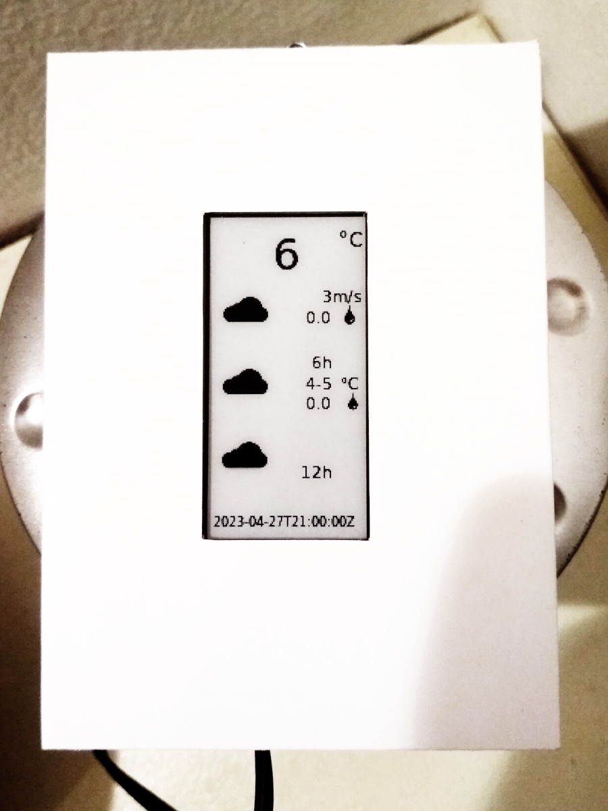
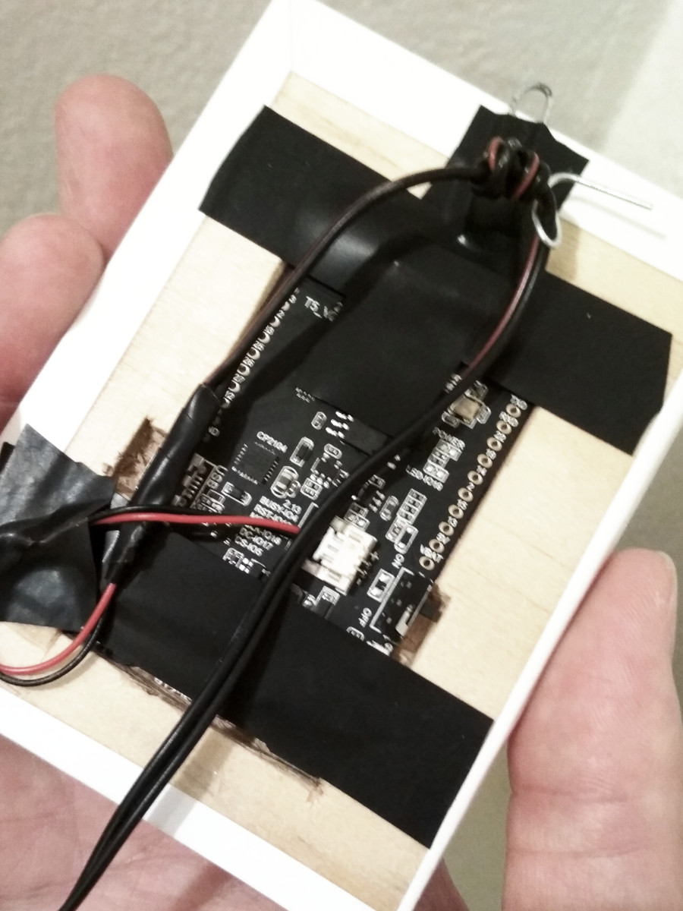

# LILYGO T5 Wifi E-Paper weather dashboard

The [server](server) uses a SVG template and data from a weather forecast API, converts it to a bitmap and serves the bitmap over HTTP.
The Arduino [client](client-arduino) connects to wifi, downloads the bitmap, displays it and goes to deep sleep for a few minutes.

